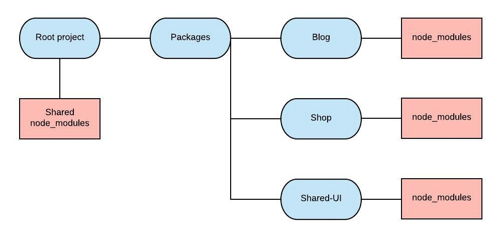

# NPM and Workspaces

- [NPM](#npm)
  - [Global vs. Local](#global-vs-local)
  - [`package.json`](#package.json)
  - [Lockfile](#lockfile)
  - [Outdated / Update versions](#update-versions)
- [Workspaces and Monorepo](#workspaces-and-monorepo)

## NPM

### Global vs. Local

Node.js 26 ships npm 11.20. The examples use npm 12, so update once:

```bash
npm install -g npm@12
```

Everything else goes into the project:

```bash
npm install zod
npm install -D vitest
```

### `package.json`

```bash
npm init
```

### Lockfile

- commit `package-lock.json`
- `npm install` updates it
- `npm ci` installs exactly what it says, use it in CI and containers

### Update versions

#### Outdated versions

```bash
npm outdated
```

#### Update version

```bash
npm update
```

### Publish to Repository

```bash
npm adduser
npm publish
```

### Ignore files

- add `.npmignore`

## Workspaces and Monorepo



1. Create the folders `apps` and `packages` in root
2. Copy your projects into these folders
3. Add a `package.json` into your root

```json
{
  "private": true,
  "workspaces": ["apps/*", "packages/*"]
}
```

4. Reference internal packages with `"*"`. `workspace:*` is pnpm and bun syntax, npm does not support it

```json
{
  "dependencies": {
    "@shop/domain": "*"
  }
}
```

5. Install in the root, then run scripts for one or all workspaces

```bash
npm install
npm test -w @shop/api
npm run test --workspaces --if-present
```

6. Add an `.npmrc` to catch undeclared imports early

```ini
install-strategy=linked
```

A runnable example with three steps (workspaces, phantom dependencies and install scripts, an internal CLI) lives in [`EXAMPLES/MONOREPO`](./EXAMPLES/MONOREPO).
